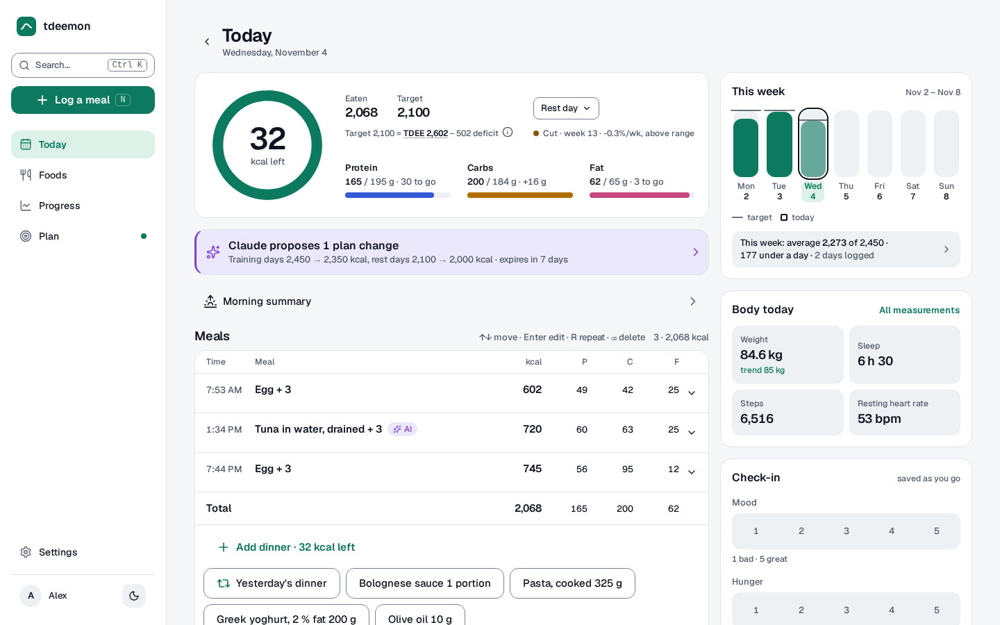
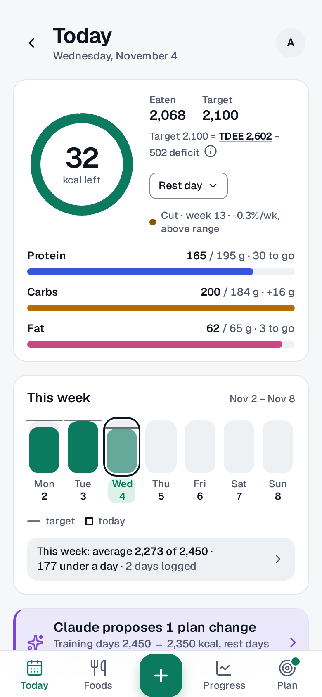
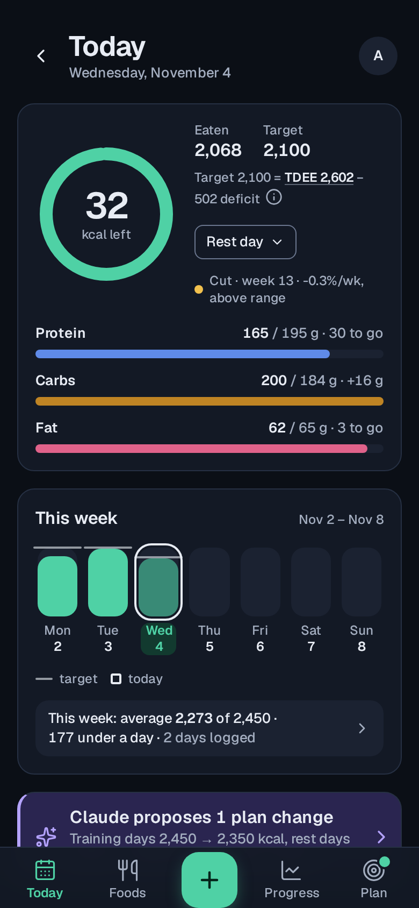
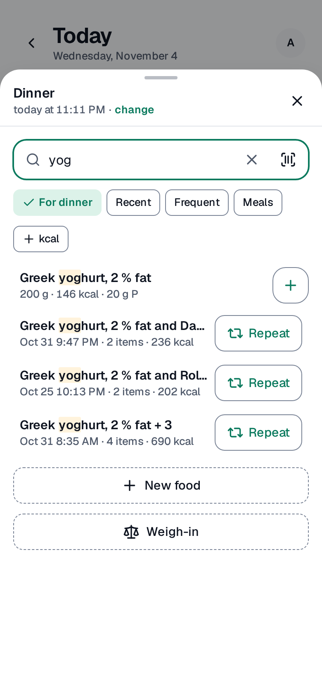
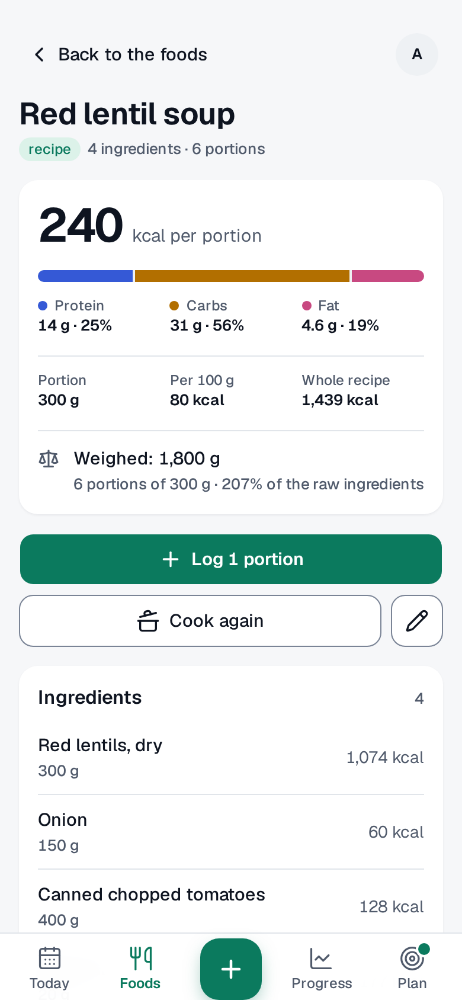
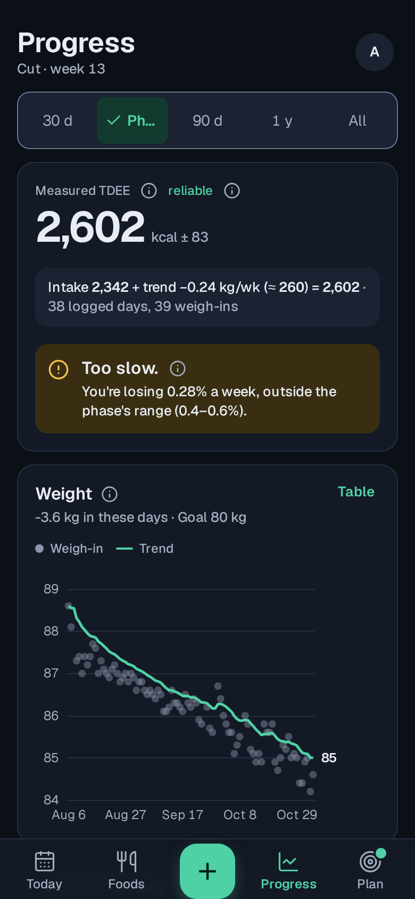
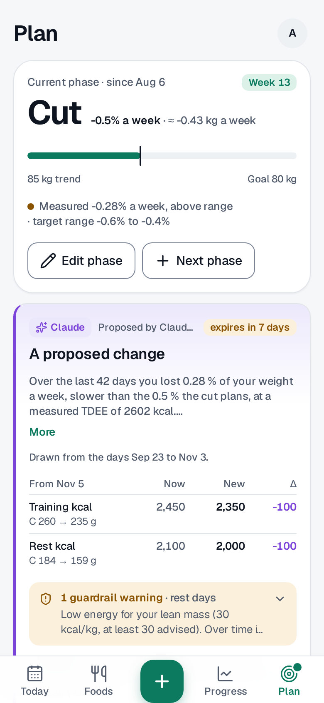
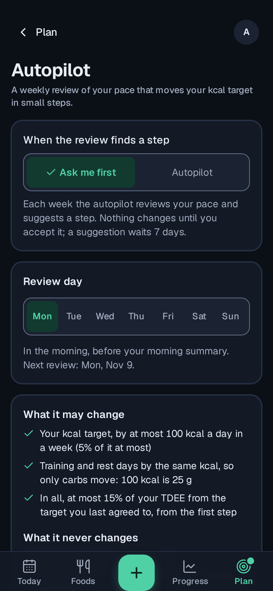
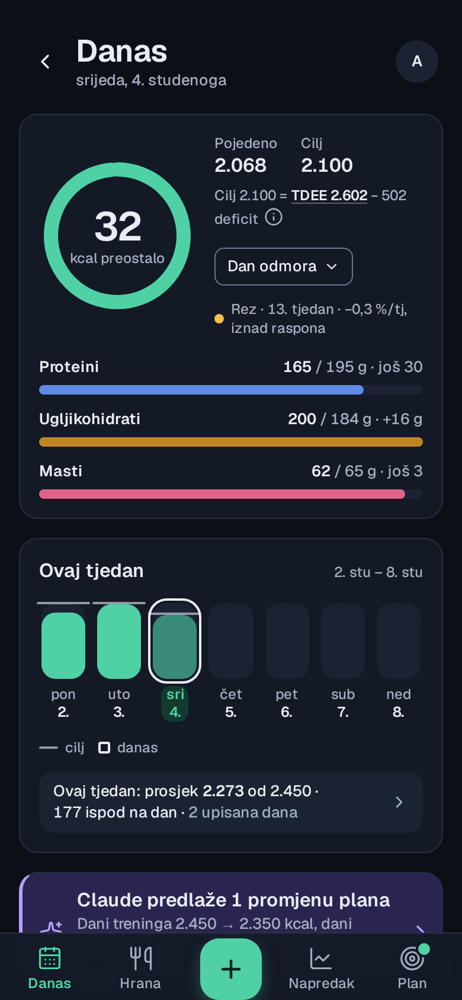

# Features

A tour of tdeemon: what each part does and how to use it. The
screenshots show a demo user (`tdeemon user demo`) with three months of
made-up data. `make screenshots` takes them again
([CONTRIBUTING.md](../CONTRIBUTING.md)).

- [The day](#the-day)
- [Logging a meal](#logging-a-meal)
- [Foods and recipes](#foods-and-recipes)
- [Your measured TDEE](#your-measured-tdee)
- [The plan](#the-plan)
- [Proposals and limits](#proposals-and-limits)
- [Autopilot](#autopilot)
- [An AI coach](#an-ai-coach)
- [Apple Health, notifications and alarms](#apple-health-notifications-and-alarms)
- [The check-in and the body](#the-check-in-and-the-body)
- [Several users and a household](#several-users-and-a-household)
- [Undo](#undo)
- [On a phone, and with a keyboard](#on-a-phone-and-with-a-keyboard)
- [Your data](#your-data)
- [Languages, themes and accessibility](#languages-themes-and-accessibility)
- [What tdeemon doesn't do (yet)](#what-tdeemon-doesnt-do-yet)

## The day

The day is the home screen. A ring shows how many calories are left of
today's target, with protein, carbs and fat as bars under it. Beside it
is the target's arithmetic: your TDEE minus the deficit your phase
plans. A small picker sets the day's type (a rest day or a training
day), which picks its target.

The week sits beside the day as seven columns, Monday to Sunday, each
against its target, with the week's average; tap it to see what the
days left can eat. Under them are the morning summary, a proposal
waiting for you, and the meals, each a row that opens to its items. Go
past your target by more than 5 % and the day says so in a warm colour,
not in an error's red.

<picture>
  <source media="(prefers-color-scheme: dark)" srcset="screenshots/desktop-day-dark.png">
  
</picture>

On a phone the same day comes as cards, with the sections in a bar at
the bottom and the button that logs a meal in its middle.

  
  

## Logging a meal

Press **Log a meal** (or N on a keyboard) and start typing. Your own
foods come first, then the instance's shared catalog. Before you type,
the sheet shows what you eat at this meal lately, what you eat most and
your meals of before, each a tap away. Tap **+** to put a food in the
tray in its usual amount; change the amounts there, and log it all at
once (⌘↵ on a keyboard). A meal you had before comes back with
**Repeat**.

Other ways in:

- **A barcode** from the camera, or its digits typed. A product you
  don't have comes from Open Food Facts.
- **A recipe's portion**, as a fraction (½, ⅓, 1/10) or in grams.
- **An estimate** in kcal alone, for a plate nobody weighed.
- **Yesterday's meal again**, from the chips under the meals.

To correct a meal, open it: change an amount or its unit, move it to
another day or time, and see its total change as you type.

## Foods and recipes

Your foods are listed by how often you eat them, this week's first.
Each has a page with its energy, the split of its macros, its nutrition
per 100 g or a serving, its barcodes and how often you logged it. The
food's form warns when its calories and macros don't add up.

A recipe is a dish of your foods that becomes a food of its own. Weigh
the pot (tdeemon remembers its empty weight), say how many portions it
made, and log a portion or a share of it. Cooked it again? Enter only
the new amounts. A recipe can be shared with another user by their
address, and an admin can add foods to the instance's catalog, which
everyone's search finds.

## Your measured TDEE

A formula's guess of your energy expenditure is only where tdeemon
starts. After a few weeks it **measures** your TDEE from what you ate
and how your trend weight moved, and shows it with its interval and
whether it is reliable yet. The sum is spelled out: intake plus the
energy of the trend's change. Until there is enough data, a bar shows
how far calibration has come and about when the first TDEE arrives.

Under it is a verdict on your phase ("Too slow: you're losing 0.28 % a
week, outside the phase's 0.4–0.6 %"). The charts show the weight and
its trend, and the TDEE in its band against what you ate, with more
layers a switch away and each chart a table a tap away. Sleep, resting
heart rate, HRV, steps and body fat come as small tiles against your
usual range. Every number has an ⓘ that says what it is, and
[the methodology](methodology.md) explains them all.

## The plan

A plan is a phase (a cut, maintenance, a bulk or a recomp) with a pace
and a goal, and targets by type of day: one for every day, or one for
training days and one for the rest. Training days come from the
weekdays you train, and a strength workout in Apple Health marks one
too. The plan's page shows the phase, the way to your goal, the
timeline of phases and the deficit the targets plan. Every change is
kept in its history, and a change can be reverted from there.

## Proposals and limits

Nobody changes your plan behind your back. An AI coach, or the
autopilot, **proposes** a change; the proposal says what changes (now,
new and the difference), who proposed it, why, what the data say and
when it expires. You accept or reject it (A or X on a desktop), and an
accepted change can be taken back.

Every proposal is checked against your limits: floors on calories,
protein and pace that the code enforces, so no prompt can talk them
down. A limit a proposal comes close to is a warning on it.
[limits.md](limits.md) lists every limit and its source.

## Autopilot

Once a week, on the weekday you choose, the autopilot reviews your pace
against the phase's. It either moves your calorie target a small step
(at most 100 kcal a day, and 15 % of your TDEE in all), holds and says
why, or, in **Ask me first** mode, proposes the step and waits for you.
It never touches protein, fat or the phase. The review comes as a push
notification or a Telegram message, shows on the day, and is kept in
the plan's history under Autopilot.

## An AI coach

tdeemon is an MCP server. Connect Claude Code, Claude Desktop, Codex,
Hermes or a local model with an access key, and talk to it: "I had
200 g of skyr and a banana", "how am I doing this week?", "do a monthly
review". The model decides only what you ate and how much: tdeemon finds
the foods, logs them and answers with the day's totals, so the model
never does the arithmetic. Three coaching sessions (a monthly review, a
plateau check, a new phase) come with the methodology, and any change
they suggest is a proposal. [ai-coach.md](ai-coach.md) has the setup and
an example.

## Apple Health, notifications and alarms

Health Auto Export, an app on an iPhone, sends
your weight, body fat, sleep, steps, resting heart rate, HRV and more,
and your strength workouts, which mark the training days. Each morning
tdeemon can send a summary of yesterday and today's target as a push
notification to each device you turn them on for, or to Telegram. If
your data stop coming (no measurement for 26 hours, or an export's key
unused for 3 days), a watchdog tells you. **Settings › Devices and AI
coaches** walks you through each device with a checklist
([self-hosting](self-hosting.md#import-from-apple-health)).

## The check-in and the body

A short daily check-in (your mood and hunger, each on five steps, and a
note) tells your coach how the days felt. It also says whether the day
was a training day, and whether calibration counts it: a day you know
is off (a party, an illness) can be left out. The body's
tiles on the day show today's weight with its trend, sleep, steps and
resting heart rate, each a tap away from its measurements. Weigh in
by hand (W on a keyboard), or let Apple Health do it.

## Several users and a household

One instance serves several people. The admin invites each by a link,
from **Settings › Users**, and each person's meals, weight and plan are
theirs alone. People who share a kitchen can make a household: every
food and recipe of each member becomes everyone's. Before you join, a
preview shows what the merge does, and a member can leave at any time.

## Undo

Every change ends in a toast with **Undo**; a delete's stays for
10 seconds, and ⌘Z or Ctrl+Z works too. **Settings › Recent changes**
lists what changed and who changed it (you, an AI coach or the
autopilot), with Undo on the latest.

## On a phone, and with a keyboard

On a phone tdeemon installs as an app (a PWA): it opens full screen
under its own icon, and without a network too. It has a bar of sections
at the bottom, and sheets you drag down to close.

On a desktop it has a sidebar and keyboard shortcuts: G and a letter to
a section, N to log a meal, W to weigh in, the arrows, Enter, R and
Delete on the meals, and ⌘K or Ctrl+K for a command palette of actions,
sections, foods, days and settings. Shortcuts of one key can be turned
off.

## Your data

Everything lives in one SQLite file in one container. Export all your
data as a ZIP of JSON and CSV at any time, or delete your account and
everything in it, from **Settings › Account**. The instance snapshots
its database before each migration and, if you set it to, every day.
Sign in with a password or your own OpenID Connect provider. The REST
API, described at `/api/v1/openapi.json` (OpenAPI 3.1), and access keys
with scopes (read, tools, ingest) let you build your own
integrations.

## Languages, themes and accessibility

tdeemon speaks English and Croatian, with each language's plurals and
clock. It has a light and a dark theme, or follows the device's. Every
screen is checked for accessibility (axe, the size of a finger's
targets, the focus, less motion) on a phone and a desktop, in both
themes and both languages.

## What tdeemon doesn't do (yet)

- **Metric units only.**
- **Apple Health only through Health Auto Export**, whose REST
  automations are a paid feature of that app. There is no Android
  health integration; the generic JSON import works for a script of
  your own.
- **No chat of its own yet**: use an MCP client.
- **No ChatGPT or claude.ai connector yet**: they sign in with OAuth,
  which tdeemon doesn't offer.
- **No hosted version**: you run it yourself.
- **Not medical advice.** Talk to a professional before significant
  changes to your diet or training.

Questions and ideas go to
[Discussions](https://github.com/tdeemon/tdeemon/discussions).
